# ❄️ RetailPulse – Snowflake Modern Data Warehouse & Semi-Structured Analytics

> Techno : **Snowflake** · Niveau : intermédiaire · Langages : SQL, Python (Streamlit)

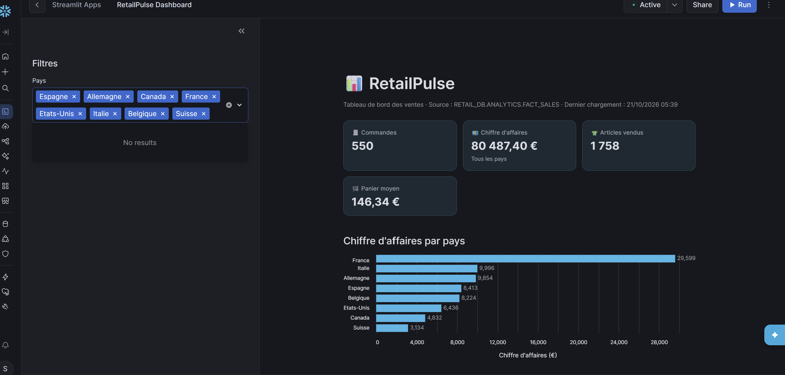

## 📌 Contexte

L'entreprise fictive **RetailPulse**, une boutique de vêtements en ligne, migre son entrepôt de données vers **Snowflake**. Son application mobile envoie chaque vente sous forme de **fichier JSON** (données semi-structurées).

L'objectif : construire un **pipeline de données complet** qui reçoit ces fichiers bruts, les transforme en données propres prêtes à l'analyse, automatise l'intégration des nouvelles ventes, protège les données contre les erreurs, et les restitue dans un **tableau de bord**.

## 🏗️ Architecture

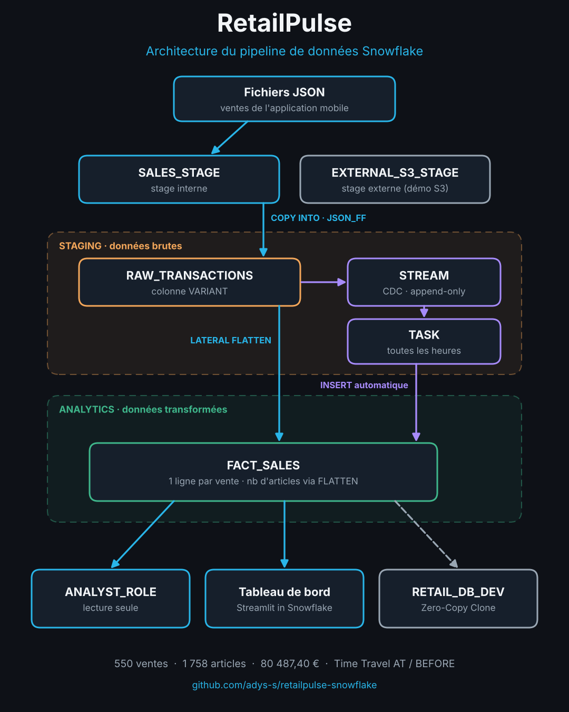
```

| Couche | Objet Snowflake | Rôle |
|---|---|---|
| Calcul | `RETAIL_WH` (X-Small, auto-suspend 60 s) | puissance de calcul dédiée au projet |
| Données brutes | `RETAIL_DB.STAGING` | réception des JSON tels quels |
| Données propres | `RETAIL_DB.ANALYTICS` | table de faits prête pour l'analyse |
| Sécurité | `ANALYST_ROLE` | lecture seule sur ANALYTICS, aucun accès à STAGING |
| Test | `RETAIL_DB_DEV` | clone zéro-copie de la production |
| Restitution | `RetailPulse Dashboard` | tableau de bord Streamlit |

## 📁 Structure du dépôt

```
retailpulse-snowflake/
├── README.md
├── sql/
│   ├── 01_infrastructure_securite.sql
│   ├── 02_ingestion_json.sql
│   ├── 03_transformation_fact_sales.sql
│   ├── 04_streams_tasks.sql
│   ├── 05_time_travel_clone.sql
│   └── 06_controles.sql
├── streamlit/
│   └── streamlit_app.py
├── data/
│   ├── retailpulse_sales_batch1.json
│   └── retailpulse_sales_batch2.json
└── images/
```

## 📦 Les données

Deux fichiers JSON simulant les ventes de l'application mobile :

| Fichier | Contenu | Période | Usage |
|---|---|---|---|
| `retailpulse_sales_batch1.json` | 500 commandes (T00001 → T00500) | 1er – 20 oct. 2026 | chargement initial |
| `retailpulse_sales_batch2.json` | 50 commandes (T00501 → T00550) | 21 oct. 2026 | simulation de nouvelles ventes (test du Stream) |

Exemple d'une vente :

```json
{
  "transaction_id": "T00001",
  "customer_info": { "id": "C0066", "email": "lucas.weber66@mail.fr", "country": "France" },
  "items": [
    { "product_id": "P04", "product_name": "Jean", "quantity": 2, "unit_price": 59.0 }
  ],
  "total_amount": 118.0,
  "event_timestamp": "2026-10-01T04:28:40Z"
}
```

Chaque vente contient un **objet imbriqué** (`customer_info`) et un **tableau** de longueur variable (`items`) : c'est ce qui rend la donnée semi-structurée.

Le jeu de données couvre **150 clients**, **8 pays** et **12 produits**, avec 1 à 4 produits différents par commande.

## 🛠️ Réalisation

### 1. Infrastructure & sécurité · [`01_infrastructure_securite.sql`](sql/01_infrastructure_securite.sql)

- Création du warehouse `RETAIL_WH`, de la base `RETAIL_DB` et des schémas `STAGING` / `ANALYTICS`.
- Création du rôle `ANALYST_ROLE` (via `SECURITYADMIN`) avec :
  - `USAGE` sur le warehouse, la base et le schéma ANALYTICS ;
  - `SELECT` sur les tables et vues **actuelles et futures** d'ANALYTICS ;
  - aucun droit sur STAGING.

**Test de sécurité** : en `ANALYST_ROLE`, avec les rôles secondaires désactivés (`USE SECONDARY ROLES NONE`) :

| ✅ Lecture d'ANALYTICS autorisée |
|---|
| 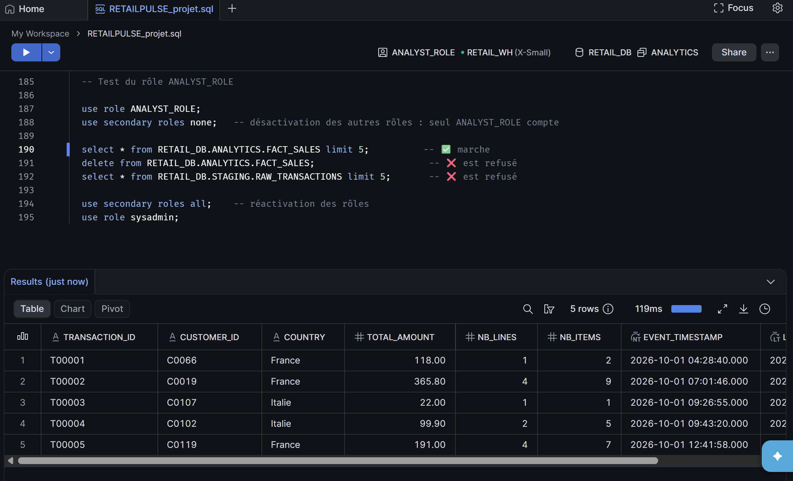 |

| ❌ Modification refusée (lecture seule) |
|---|
| 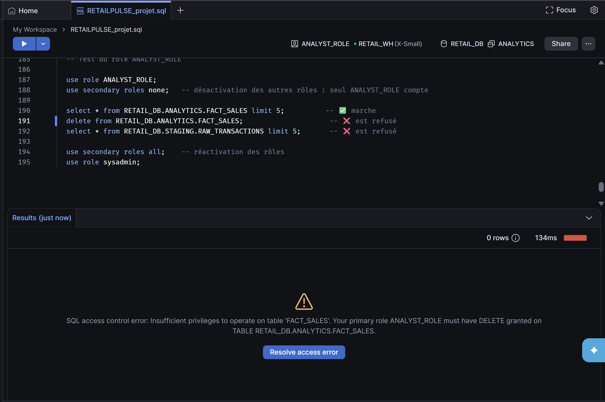 |

| ❌ Accès aux données brutes refusé |
|---|
| 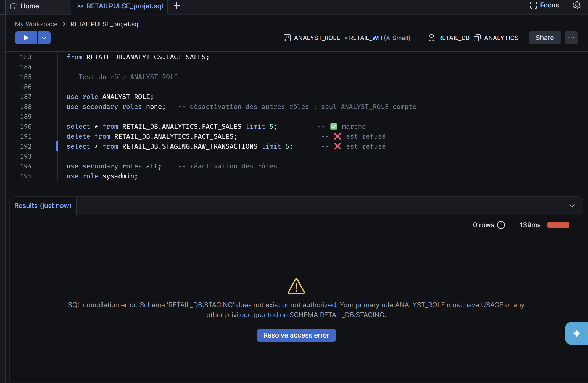 |

> 💡 Point appris : sur les comptes Snowflake récents, les **rôles secondaires** sont tous actifs par défaut. Pour tester réellement un rôle restreint, il faut les désactiver, sinon les droits d'un rôle plus puissant s'appliquent en arrière-plan.

### 2. Ingestion des données semi-structurées · [`02_ingestion_json.sql`](sql/02_ingestion_json.sql)

- **Stage interne** `SALES_STAGE` pour déposer les fichiers.
- **Stage externe** `EXTERNAL_S3_STAGE` (démonstration) pointant vers un bucket Amazon S3 public.
- **Format de fichier** `JSON_FF` avec `STRIP_OUTER_ARRAY = TRUE` : une ligne par vente au lieu d'une seule ligne pour tout le fichier.
- **Table** `STAGING.RAW_TRANSACTIONS` : une colonne `VARIANT` pour le JSON brut, plus deux colonnes de traçabilité (`FILE_NAME`, `LOADED_AT`).
- Chargement avec `COPY INTO` et `METADATA$FILENAME`.

**Stage externe** : Snowflake lit directement les fichiers stockés sur S3.

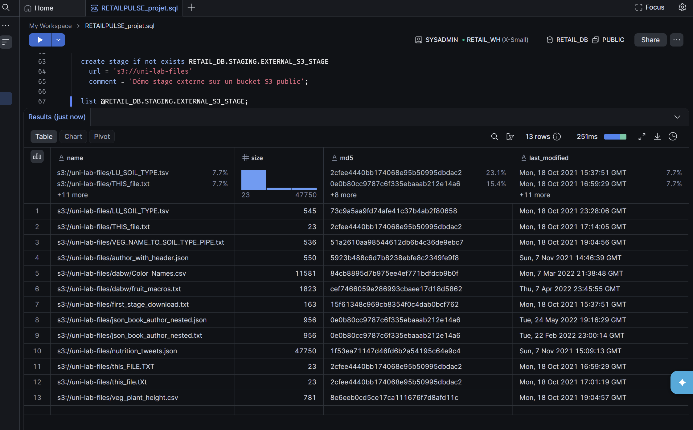

**Données brutes** : chaque vente est stockée telle quelle dans la colonne VARIANT.

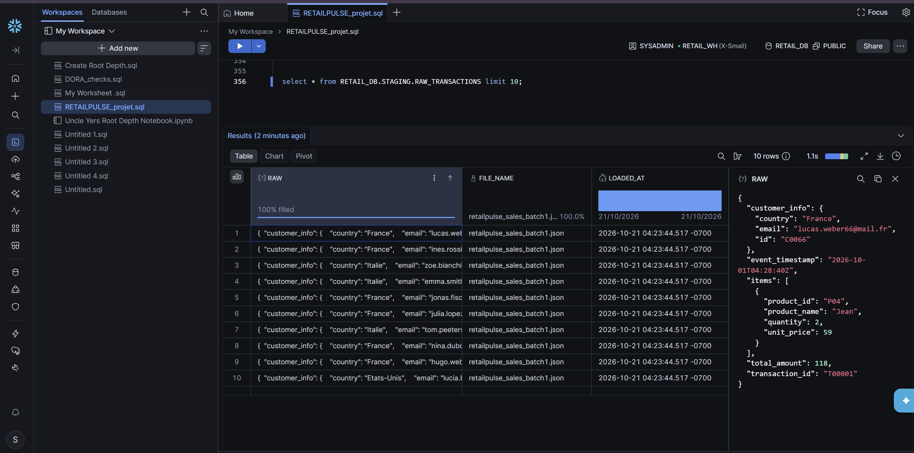

### 3. Transformation & extraction du JSON · [`03_transformation_fact_sales.sql`](sql/03_transformation_fact_sales.sql)

- Extraction des champs avec la notation par chemin (`RAW:customer_info.country::string`).
- Dépliage du tableau `items` avec **`LATERAL FLATTEN`** pour calculer :
  - `NB_LINES` : nombre de produits différents par commande ;
  - `NB_ITEMS` : nombre total d'articles (somme des quantités).
- Alimentation de la table de faits `ANALYTICS.FACT_SALES`.

```sql
select
  RAW:transaction_id::string,
  RAW:customer_info.id::string,
  RAW:customer_info.country::string,
  RAW:total_amount::number(10,2),
  count(*)                          as NB_LINES,
  sum(item.value:quantity::number)  as NB_ITEMS,
  RAW:event_timestamp::timestamp_ntz
from RETAIL_DB.STAGING.RAW_TRANSACTIONS,
lateral flatten(input => RAW:items) item
group by 1, 2, 3, 4, 7;
```

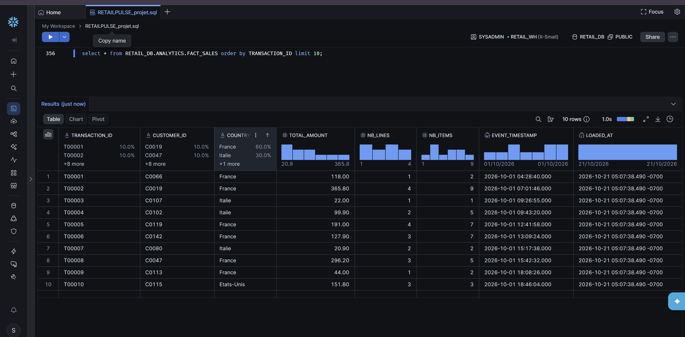

### 4. Automatisation & CDC (Streams & Tasks) · [`04_streams_tasks.sql`](sql/04_streams_tasks.sql)

- **Stream** `RAW_TRANSACTIONS_STREAM` (`APPEND_ONLY = TRUE`) : capture uniquement les nouvelles lignes insérées dans STAGING.
- **Task** `LOAD_FACT_SALES_TASK` :
  - planifiée toutes les heures (`SCHEDULE = '60 MINUTE'`) et exécutable à la demande (`EXECUTE TASK`) ;
  - condition `WHEN SYSTEM$STREAM_HAS_DATA(...)` : le warehouse n'est démarré que s'il y a de nouvelles données ;
  - insère dans FACT_SALES uniquement les ventes du Stream, qui se vide ensuite automatiquement.

**Le Stream détecte les 50 nouvelles ventes** du batch2 (`METADATA$ACTION = INSERT`) :

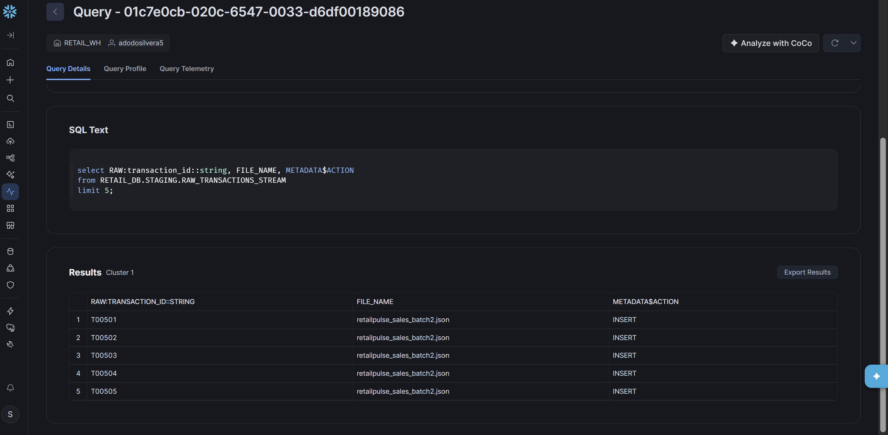

**La Task s'exécute avec succès** et les intègre dans FACT_SALES (500 → 550 ventes) :

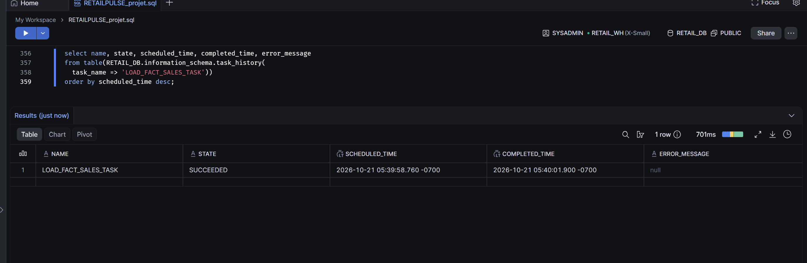

### 5. Time Travel & Zero-Copy Clone · [`05_time_travel_clone.sql`](sql/05_time_travel_clone.sql)

**Time Travel** :
- mise à jour simulée : remise de 10 % sur les ventes françaises ;
- interrogation de la table avant la modification avec `AT(TIMESTAMP => ...)` et `BEFORE(STATEMENT => ...)` ;
- restauration de la table avec `INSERT OVERWRITE ... BEFORE(STATEMENT => ...)`.

| Après la mise à jour (CA réduit) | Avant la mise à jour, vu grâce à Time Travel |
|---|---|
| 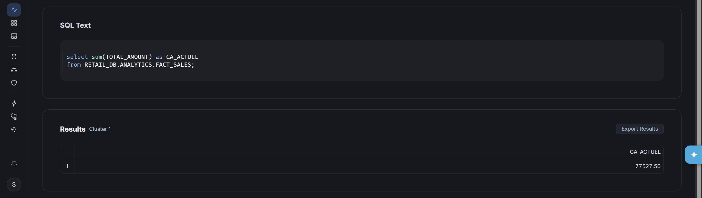 | 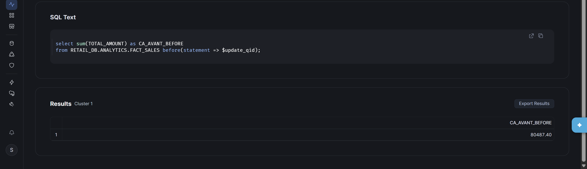 |

**Zero-Copy Clone** : `CREATE DATABASE RETAIL_DB_DEV CLONE RETAIL_DB` crée un environnement de test complet en quelques secondes, sans dupliquer le stockage. Les ventes françaises supprimées dans le clone restent intactes en production (voir le contrôle final).

### 6. Tableau de bord Streamlit · [`streamlit_app.py`](streamlit/streamlit_app.py)

Application **Streamlit in Snowflake** qui lit directement `ANALYTICS.FACT_SALES` :
- **4 indicateurs** : commandes, chiffre d'affaires (avec sa part du CA global), articles vendus, panier moyen ;
- **chiffre d'affaires par pays** (barres) et **par jour** (courbe), réalisés avec Altair ;
- les **dernières ventes** ;
- un **filtre par pays** qui met à jour toute la page.

**Évolution du chiffre d'affaires** : le pic du 21/10 correspond aux 50 ventes du batch2, intégrées automatiquement par le Stream et la Task.

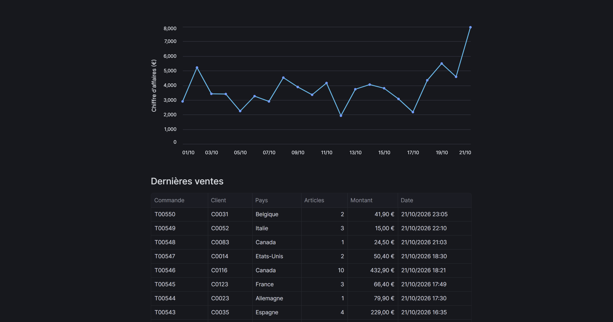

**Filtre sur la France** : 206 commandes et leur part du chiffre d'affaires global.

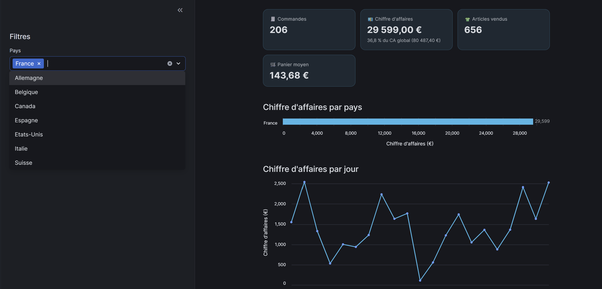

## ✅ Contrôles de qualité · [`06_controles.sql`](sql/06_controles.sql)

Chaque étape a été validée par des chiffres de contrôle calculés à partir des fichiers sources :

| Contrôle | Attendu | Obtenu |
|---|---|---|
| Ventes dans FACT_SALES (production) | 550 | ✅ 550 |
| Articles vendus | 1 758 | ✅ 1 758 |
| Chiffre d'affaires | 80 487,40 € | ✅ 80 487,40 € (après restauration Time Travel) |
| Lignes dans STAGING | 550 | ✅ 550 |
| Stream après exécution de la Task | 0 | ✅ 0 |
| Clone DEV après suppression des ventes France | 344 (550 − 206) | ✅ 344, production intacte |

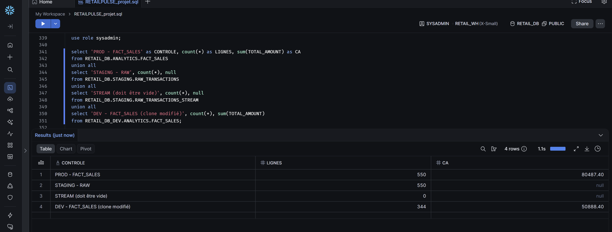

## ▶️ Reproduire le projet

1. Créer un compte d'essai Snowflake (30 jours, sans carte bancaire).
2. Exécuter `sql/01_infrastructure_securite.sql` (remplacer le nom d'utilisateur à la fin du fichier).
3. Exécuter `sql/02_ingestion_json.sql` en téléversant `data/retailpulse_sales_batch1.json` dans le stage `SALES_STAGE` à l'étape indiquée.
4. Exécuter `sql/03_transformation_fact_sales.sql`.
5. Exécuter `sql/04_streams_tasks.sql` en téléversant `data/retailpulse_sales_batch2.json` à l'étape indiquée.
6. Exécuter `sql/05_time_travel_clone.sql` dans une même session.
7. Vérifier avec `sql/06_controles.sql`.
8. Créer une app Streamlit dans `RETAIL_DB.ANALYTICS` (warehouse `RETAIL_WH`) et y coller `streamlit/streamlit_app.py`.

## 🎓 Ce que j'ai appris

- La séparation **stockage / calcul** de Snowflake et la gestion des coûts (auto-suspend, condition `WHEN` des Tasks).
- La chaîne d'ingestion **fichier → stage → format de fichier → table**, avec des stages internes et externes.
- Le type **VARIANT** et l'interrogation du JSON (`:`, `.`, `::`, `LATERAL FLATTEN`).
- Le **contrôle d'accès** par rôles, les droits `FUTURE` et le piège des rôles secondaires.
- Le **CDC** avec les Streams et l'automatisation avec les Tasks.
- **Time Travel** pour revenir dans le passé et réparer une erreur, et **Zero-Copy Clone** pour tester sans risque.
- La création d'un **tableau de bord Streamlit** directement dans Snowflake.
- L'importance de **chiffres de contrôle** pour valider un pipeline.

## 🚀 Pistes d'amélioration

- Remplacer le stage externe de démonstration par **mon propre bucket S3** (storage integration + rôle IAM).
- Automatiser l'ingestion avec **Snowpipe** dès l'arrivée d'un fichier.
- Ajouter des **tables de dimensions** (clients, produits) pour un vrai modèle en étoile.
- Enrichir le tableau de bord : top produits, analyse des clients récurrents.

---

🏅 Prérequis validé : badge **Snowflake Hands-On Essentials – Data Warehousing Workshop**.

## 👤 Auteur

**Yawa Silvère ADODO-DAHOUE**

- 💼 LinkedIn : [linkedin.com/in/silvereadodo](https://www.linkedin.com/in/silvereadodo)
- 🐙 GitHub : [github.com/adys-s](https://github.com/adys-s)

N'hésitez pas à me contacter pour échanger sur ce projet ou sur la data !
